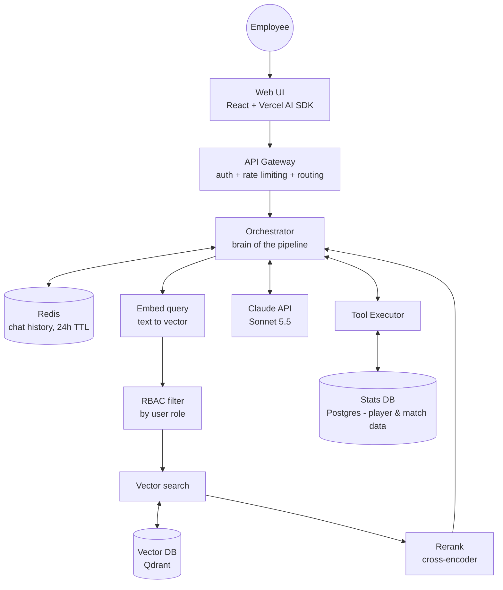

# System Design: Enterprise RAG Chat for Manchester United

**Author:** Lloyd Fernandes
**Date:** 2026-10-24
**Status:** Draft v1

---

## 1. Problem

## 1. Problem

Manchester United (~8,000 employees across 12 offices) wants an internal chat assistant that answers natural-language questions over a mixed corpus: HR policies, benefits documentation, IT runbooks, past support tickets, and the club's historical sporting records / player statistics. Today, employees broadcast simple questions in Slack ("does anyone know who was the top scorer last year?" or "how does PTO carryover work?") and wait minutes or hours for a human answer. The assistant replaces this ad-hoc broadcast pattern with a self-serve conversational interface.

More importantly, the same interface removes a deeper bottleneck: non-technical employees (managers, department heads, product owners) who need data analysis today must file a business requirements document (BRD) and wait for the data analyst or data science team to prioritize, query, and return insights — a cycle that often takes days or full sprints. By exposing structured stats and documents behind a natural-language interface, the assistant lets non-technical users self-serve routine analytical questions, freeing the data team to focus on complex, novel work rather than repeat queries.

Internal use only — no customer-facing exposure, no public API, no fan-facing surface.
## 2. Requirements

### Functional
- Internal employees ask natural-language questions via web UI
- Chat returns answers with citations (which doc, which section)
- Multi-turn conversations (follow-ups referencing prior answers)
- Role-based access: queries + results filtered by user permissions
- Data sources: HR policies, benefits docs, IT runbooks, past support tickets, structured sports/player stats database

### Non-functional
- **Latency:p95 < 5 sec for first token,p95<10 sec for full response**
- **Throughput:80000 queries/day -> around 8000 queries/hour average given a 10 hours work day->2.2 queries/sec average**
- **Availability:7 days downtime/year = (7×24) / (365×24) = 1.9% downtime = 98.1% uptime**
- **Cost ceiling:$5000/month (~$0.002/query budget — tight, forces model routing)**
- **Data isolation:Document-level ACLs, enforced at retrieval time (not post-hoc filtering)**
- **Compliance:DPR-compliant audit trail (90-day retention), DPA with LLM provider,no training on prompts, no retention at provider**

## 3. High-level architecture

**Design decisions reflected above:**
- Orchestrator is the hub — all retrieval, memory, tool results flow back to it before reaching the LLM
- RBAC filtering happens BEFORE vector search (pre-filter, not post-filter)
- Memory is Redis-only in v1 (long-term Postgres memory deferred to v2)
- Tool use is LLM-decided — orchestrator sends tool definitions in the LLM request; the LLM chooses whether to invoke them
- Model fixed to Sonnet 5.5 in v1; model routing (Haiku/Opus) deferred to v2
- Response path (orchestrator → gateway → UI → user) is symmetric and omitted from diagram for clarity

## 4. Component responsibilities

[For each major box in your diagram, 2-3 sentences on what it does and why it's separate.]

### 4.1 Web UI
### 4.2 API Gateway
### 4.3 Auth Service
### 4.4 Orchestrator
### 4.5 Retrieval Layer
### 4.6 Vector Database
### 4.7 Structured Data Router
### 4.8 LLM Service (Claude)
### 4.9 Document Ingestion Pipeline
### 4.10 Audit + Observability

## 5. Query lifecycle

[Numbered step-by-step: what happens from user hitting enter to response rendered. This is the "walk me through a request" section every design doc needs.]

## 6. Key design decisions + tradeoffs

### 6.1 Why Qdrant over Pinecone/Chroma?
### 6.2 Why separate orchestrator from gateway?
### 6.3 Why hybrid retrieval (vector + structured)?
### 6.4 Model routing: Haiku vs Sonnet
### 6.5 Role-based access: filter at retrieval, not post-hoc

## 7. Failure modes

[For each: what fails, how we detect it, how we degrade gracefully.]

- Claude API down →
- Vector DB down →
- Permissions service down →
- Query latency exceeds SLO →
- Cost spike (viral internal moment) →

## 8. Cost analysis

[Rough math. Per-query cost, monthly projection, headroom to the $5000 ceiling.]

## 9. What I'd build in v1 vs defer to v2

[Scope control. v1 is 2-week ship; v2 is 2-month maturation.]

## 10. Open questions

- Scope of analytical queries supported in v1: factual lookups only (`get_top_scorer(season)`) or does the system attempt free-form SQL generation ("show me players with >15 goals in home games")? v1 should likely be narrow — pre-defined tool functions — with free-form SQL deferred to v2 after we understand real query patterns.
- Does "insights" mean text answers only, or do we need to render charts/tables? If charts, we need a visualization layer not currently in the design.
- How do we handle queries that MIX document retrieval and structured analysis ("What's our policy on bonuses, and who got the biggest bonus last year?")? Orchestrator sequencing matters.